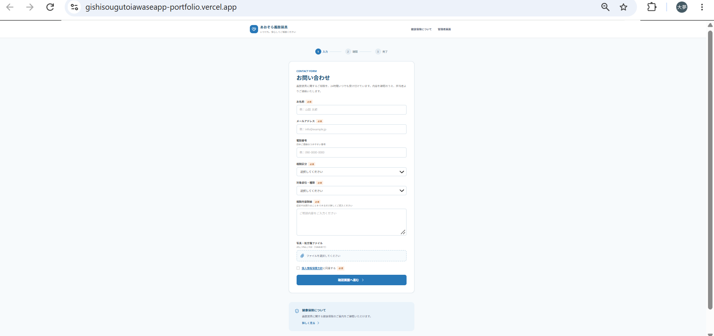

## アプリ概要
v0とSupabaseを用いた義肢装具問い合わせアプリです。 

## サイトURL
- https://gishisougutoiawaseapp-portfolio.vercel.app/

## アプリ画面
-

## 機能一覧
- お問い合わせフォーム機能（マルチステップ形式：入力・確認・完了）
  - 入力値のリアルタイムバリデーション
  - 確認画面での入力内容プレビューおよび修正（戻る）機能
- 画像添付・ファイルアップロード機能
  - Supabase Storageを利用した画像データの保存
- データベース連携機能
  - Supabaseへの問い合わせデータの永続化
- 情報案内・規約表示機能
  - 健康保険の適用に関する案内表示
  - 個人情報保護方針（プライバシーポリシー）の表示

## 使用技術
- フロントエンド：v0
- バックエンド：v0
- データベース：Supabase
- デプロイ：Vercel
- バージョン管理：GitHub

## 設計ドキュメント
[要件定義・基本設計・詳細設計の一覧_Googleスプレッドシート](https://docs.google.com/spreadsheets/d/1_3lhP4GSvViJ-OFzfw2X2e3fTbZl6lCIsjteVvZ9n4A/edit?usp=sharing)

詳細設計時のワイヤーフレーム、ER図、ワークフロー図の画像はdocsディレクトリに格納しています。（[こちらからアクセス](./docs)）

## テスト・修正の設計及び実施書
[テスト・修正の設計及び実施書_Googleスプレッドシート]
https://docs.google.com/spreadsheets/d/16EuLtLkF3nOp9czery5JTCkhsf7NpRam4VvXGgA2LWs/edit?usp=sharing

## アプリの改善案
[アプリの改善案_Googleスプレッドシート]
https://docs.google.com/spreadsheets/d/14rHorje6nrb2VqGwnouRmNAFGWE0Uuo88TwHPlU9ivA/edit?usp=sharing

- 活用した生成AIとその用途
  - ChatGPT：要件定義、設計、各種リサーチ
  - v0：アプリのモック作成
  - GitHub Copilot Chat：ローカル環境でのコードの修正相談

